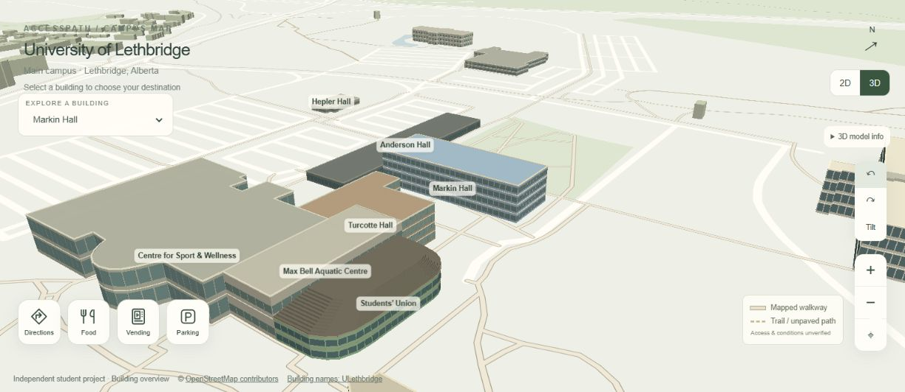
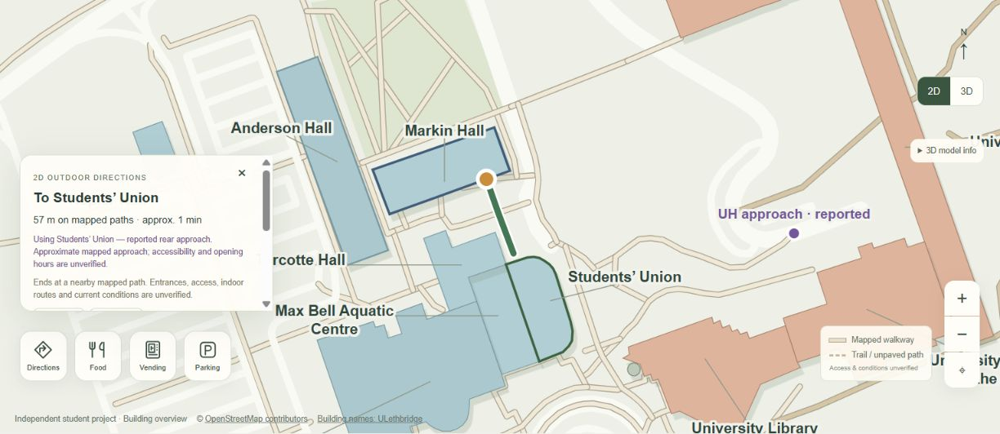

# AccessPath ULeth

[Quick start](#run-locally) · [Features](#features) · [Report and demos](#report-and-demonstrations) · [Limitations](#known-limitations)

A custom 2D and 3D campus map and outdoor wayfinding prototype for the University of Lethbridge, built by Deep, a final-year Computer Science student.

Explore buildings, plan outdoor walking journeys, find dining and vending buildings, and view parking areas through a browser interface. The longer-term goal is to support verified accessible campus journeys.



**Status:** independent student prototype. Outdoor routes follow the bundled mapped paths. Indoor room-to-room routing, elevator navigation and verified wheelchair-accessible routing are future work. The university has not endorsed this project.

## Features

- Custom SVG campus map with 131 building footprints and 18 labeled campus landmarks.
- MapLibre GL JS exterior 3D scene with building selection, rotation, tilt and close-up inspection.
- Start and destination selection by building or supported room-code prefix; rooms and floors are optional.
- Room-code building and floor inference with clear verification limits.
- Outdoor path routing using Dijkstra's algorithm, distance estimates and numbered directions.
- Browser location permission flow and optional live outdoor route progress.
- Food, vending and parking overlays that reduce unrelated labels.
- Optional food stop as an intermediate building on a journey.
- Stored parking guidance with links to current university rules.
- Reported University Hall west approach and Students' Union rear approach.
- Keyboard controls, semantic buttons, focus handling and responsive layout.

The simulated navigation animation was removed. The MP4s in this repository are screenshot presentations, not live tracking recordings.

## Run locally

Install Node.js 20 or later. There are **no npm dependencies to install**.

```sh
git clone https://github.com/deepmevada071-ui/accesspath-uleth.git
cd accesspath-uleth
npm start
```

Open **http://localhost:8080**. The server serves `dist/` only and binds to localhost. For a different port:

```sh
npm start -- --port 8081
```

Alternatively, with Python installed:

```sh
python -m http.server 8080 --directory dist
```

Use an HTTP server rather than opening `index.html` directly because the map fetches JSON data. Device location needs browser permission and a secure context such as HTTPS or localhost. The 3D scene needs WebGL; the 2D map remains available when 3D cannot initialize.

## Check the project

```sh
npm run check
npm test
```

`check` validates JavaScript syntax, parses JSON and verifies local application asset links. `test` runs the entrance-route regression checks against the bundled map data. GitHub Actions runs both checks on pushes and pull requests.

The tested Markin Hall to Students' Union route is approximately **57 m**, compared with approximately **336 m** using the original perimeter snapping choice. Tests also cover reverse routing, a southern approach and the existing University Hall approach. These are computations on the map, not field-measured distances.

## Technology and source layout

| Component | Technology and source |
|---|---|
| Page and responsive UI | HTML5 and CSS3 in `dist/index.html` |
| 2D map and planner | Plain JavaScript and SVG in `dist/map.js` |
| 3D scene | MapLibre GL JS, WebGL and GeoJSON in `dist/map3d.js` |
| Exterior appearance | Procedural geometry and profiles in `dist/architecture.js` |
| Outdoor path graph | JavaScript and Dijkstra in `dist/routing.js` |
| Route display and location | Browser Geolocation API and JavaScript in `dist/navigation.js` |
| Geographic data | `dist/campus.json`, `dist/heights.json` and `dist/parking.json` |
| Reported entrances | `dist/reported-entrances.json`; runtime coordinates also occur in `navigation.js` |
| Height preparation | `prepare-heights.cjs` and the city elevation extract |
| Historical room research | `research/uleth-floor-room-audit.md` and JSON |
| Local tooling | Dependency-free Node scripts in `scripts/` |

No application backend, database, framework, Google Maps key or paid routing API is required. MapLibre and its licence are bundled in `dist/vendor/`. Campus JSON records are converted to GeoJSON for the 3D renderer at runtime.

## Report and demonstrations

- [Read the full project report](docs/AccessPath-ULeth-Project-Report.md).
- [Download the illustrated Word report](docs/AccessPath-ULeth-Project-Report.docx).
- [Campus overview MP4](docs/media/01-campus-overview.mp4) — about 20 seconds.
- [Navigation and services MP4](docs/media/02-navigation-and-services.mp4) — about 15 seconds.
- [Screenshot and media index](docs/MEDIA.md).

The Word report contains seven screenshots and links to the companion videos. Download or clone the repository to keep its `docs/media` folder beside the report. GitHub may offer the DOCX and MP4 files as downloads rather than rendering them inline.



## Hosting

Any static host can serve `dist/`. A manual GitHub Pages deployment workflow is supplied in `.github/workflows/pages.yml`.

To use it, select **Settings → Pages → Source → GitHub Actions**, then run **Actions → Deploy GitHub Pages → Run workflow**. This is optional; pushing the repository does not automatically publish a new website. Preserve attribution and review the data notices before broader distribution.

## Known limitations

- Avoiding mapped stairs does **not** establish wheelchair accessibility. Widths, slopes, doors, curb transitions and conditions need verification.
- Routes generally end at nearby path nodes; reported entrances are approximate approaches with unverified hours and access.
- Room inference does not verify room existence, floor plans or an indoor connection. PE is an ambiguous prefix across sports facilities.
- The 3D terrain is flat. Window bands, roofs and facade rows are illustrative rather than architectural measurements or floor inventories.
- Height matching is approximate: 126 footprints have city matches and five use estimates; broad city polygons can match several structures.
- GPS progress uses the nearest stored route vertex and does not automatically reroute.
- Parking rules and food and vending details are stored information, not live availability.
- Room research includes a **2014 classroom inventory**, not current complete room counts.
- No completed accessibility conformance audit, usability study or route-completion evaluation is claimed.

## Future development

1. Verify a small set of outdoor routes and entrances with campus users and staff.
2. Improve endpoint selection, GPS progress and data maintenance.
3. Obtain approved floor plans for a one-building indoor pilot.
4. Model doors, corridors and floor-specific nodes with explicit stair and elevator connectors.
5. Add accessibility attributes and validate them before describing routes as accessible.
6. Consider obstacle reporting and camera positioning only after the verified mapping foundation is in place.

## Data sources and attribution

Geographic data includes OpenStreetMap-derived geometry, City of Lethbridge elevation records and university directory information. See [DATA_SOURCES.md](DATA_SOURCES.md) and [THIRD_PARTY_NOTICES.md](THIRD_PARTY_NOTICES.md) for provenance and licence boundaries.

Everett Blakley's WayFinder was investigated as prior work. Its source, scene package, CAD, room geometry and routing data are **not included** in this repository. Reference photographs and the professor-supplied report are also not redistributed here.

## Licence

Original application code is offered under the [MIT licence](LICENSE). Third-party software, geographic data, university material and report source references retain their own terms. The MIT licence does not override those terms.
