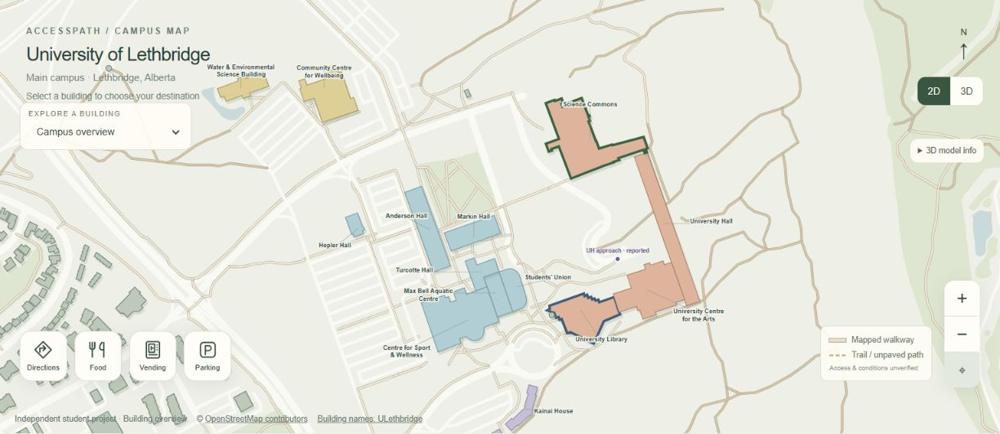
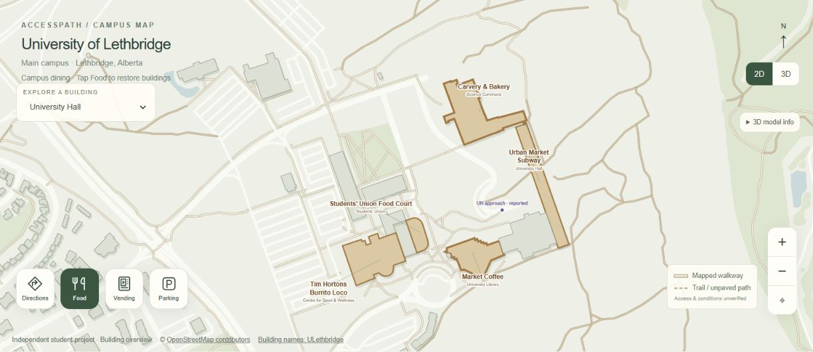
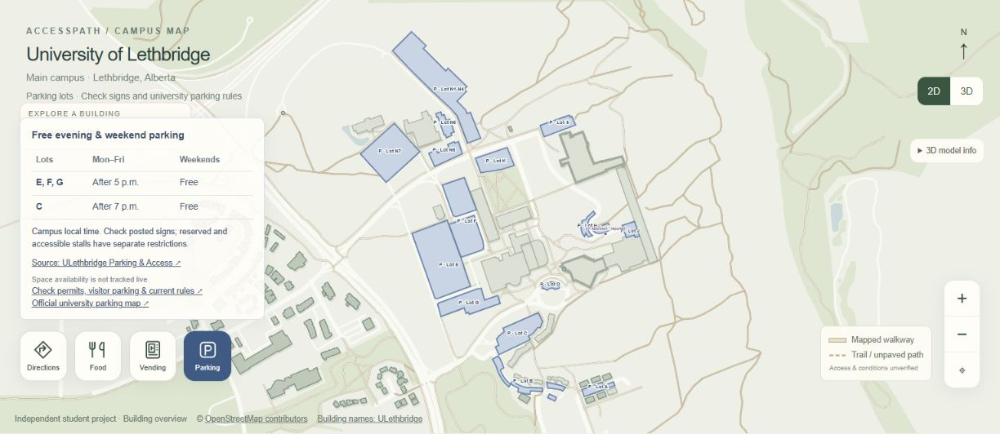
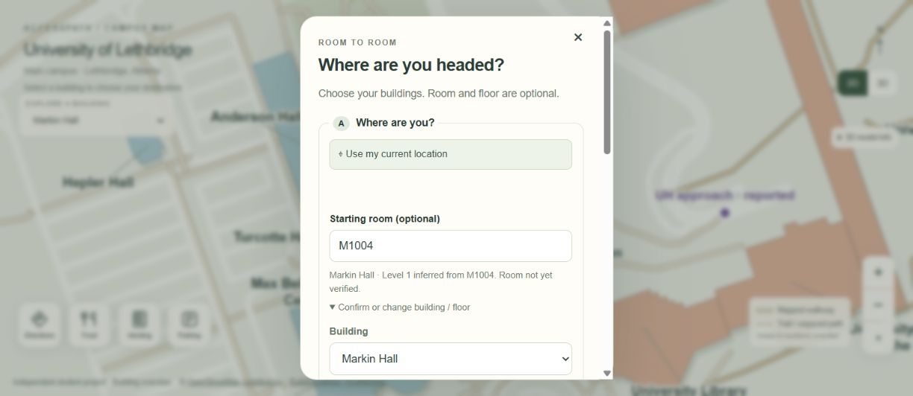
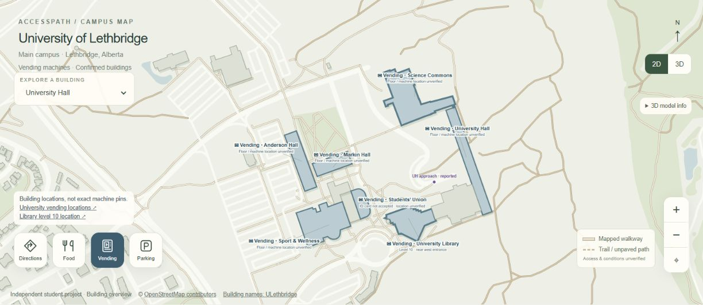

# AccessPath ULeth Project Report

Technical implementation and future development

Prepared for Deep | Final year Computer Science student | University of Lethbridge

Project snapshot 30 October 2026 | Source commit b5073f7d604e166d354e0e6cd4353fb57c4bda70

## Project overview

AccessPath ULeth is an independent student project that helps people explore the University of Lethbridge campus and plan outdoor journeys between buildings. The current prototype provides a custom campus map, stylized exterior 3D buildings, building selection, room-code interpretation, outdoor walking routes, optional food stops, vending information and parking information.

The long-term purpose is to make campus travel easier for students, visitors and people with mobility disabilities. The current application is a working outdoor navigation prototype. It does not yet provide verified wheelchair-accessible routes, indoor room-to-room directions or elevator navigation.

The application runs in a web browser without requiring an app installation. Its own campus geometry is served with the website rather than embedded through Google Maps. HTML defines the interface, CSS controls presentation, and plain JavaScript handles rendering, interaction, routing and device location.

### Current project at a glance

| Item | Current implementation |
|---|---|
| Project owner | Deep |
| Delivery | Static browser application hosted through Sites |
| Main languages | HTML5 CSS3 and JavaScript |
| 2D renderer | Custom SVG map |
| 3D renderer | MapLibre GL JS with GeoJSON and WebGL |
| Routing | Browser-side graph construction and Dijkstra shortest paths |
| Map snapshot | 131 building footprints and 18 named campus landmarks |
| Supporting layers | 29 parking polygons and 318 highway-tagged map features |
| Routing graph | 1670 nodes in 7 connected components |
| Positioning | Browser Geolocation API for outdoor location |

Counts describe the current bundled dataset, not the university's complete building or room inventory. Highway-tagged features include roads as well as paths; only eligible walking segments enter the routing graph.

### How to read this report

The following pages document the implemented features, component responsibilities, mapping and routing methods, location behavior, research findings, limitations and a staged continuation plan. File names and function names refer to the source snapshot above. Proposed work is explicitly identified.

Live website: [AccessPath ULeth](https://accesspath-uleth-campus-deep.shukanforwork.chatgpt.site/)

<!-- PAGE -->
## Implemented features

| Feature | What the application currently does |
|---|---|
| Campus overview | Opens on the Lethbridge campus with building outlines, walkways, landscape areas and selected building names. The 3D view starts when it loads successfully. |
| Interactive buildings | Building footprints and named labels open the journey planner. Building selection is available for both the start and destination. |
| Journey planner | Provides Where are you and Where to fields, map-based building picking, a swap control and optional room and floor fields. |
| Room interpretation | Recognizes supported room-code prefixes and infers a building and level. It states that room existence has not been verified. |
| Map exploration | Supports 2D pan and zoom, map reset, a 2D and 3D switch, and 3D rotation, tilt and building close-ups. |
| Outdoor directions | Computes a continuous route through the available walking graph, displays its length and estimated duration, and generates numbered turn instructions. |
| Device location | Requests the user's location when selected and can update the position marker and route progress outdoors. |
| Food mode | Shows dining labels and suppresses unrelated building labels. Includes the Students' Union food court as a map label. |
| Optional food stop | Adds a supported dining building as an intermediate route endpoint. Directions do not reach the indoor counter. |
| Vending mode | Shows seven buildings associated with vending. Most exact machine positions and floors remain unverified. |
| Parking mode | Shows named parking polygons, fits the map to parking areas and presents links to official parking guidance. |
| Parking guidance | Displays stored guidance for E F G after 5 p.m. weekdays and C after 7 p.m.; weekends free. Users must check signs and current rules. |
| Reported entrances | Includes a University Hall west approach and an alternative Students' Union rear approach based on Deep's map annotations. |
| Source transparency | Links to university information, OpenStreetMap attribution, city open data and the MapLibre licence. Shows uncertainty notes. |

### Dining and vending coverage

The optional food-stop selector contains Urban Market, Subway, Carvery and Bakery, Market Coffee, Tim Hortons and Burrito Loco. The food overlay groups these by building and adds the Students' Union food court. Names and operating availability are stored information and require periodic checks.

The vending overlay covers University Hall, Science Commons, University Library, Sport and Wellness, Anderson Hall, Markin Hall and Students' Union. Library level 10 near the west entrance is specifically described; the other markers primarily identify buildings.

### Navigation presentation

Confirm and start navigation opens numbered 2D directions, or starts live outdoor location guidance when the user chose current location. The simulated moving navigation animation was removed at Deep's request. Camera transitions used for ordinary map exploration remain.

<!-- PAGE -->
## Languages libraries and component responsibilities

The application has no framework build step. The browser loads the HTML document, local scripts, the MapLibre library and JSON datasets. There is no application database, custom API server, account system or report moderation dashboard in this version. Sites provides hosting and access control separately from the client application.

| Technology | Role in the project |
|---|---|
| HTML5 | Page structure, semantic controls, journey form, dialog, map containers and information panels. |
| CSS3 | Responsive layouts, map styling, building colors, selected states, overlays, focus presentation and small-screen adjustments. Styles are inline in index.html. |
| JavaScript | DOM events, shared state, coordinate processing, map rendering, route computation and geolocation behavior. |
| SVG | Scalable 2D polygons, paths, labels, icons, route polylines and position markers. |
| MapLibre GL JS | Locally bundled 3D map engine using WebGL, GeoJSON sources, extrusion layers and DOM markers. |
| JSON and GeoJSON | Stored campus records and heights; GeoJSON objects are constructed for MapLibre at runtime. |
| Node.js | Data preparation, JavaScript syntax checks, route regression checks and Sites source packaging. |
| Git and Sites | Versioned source, deployment archives and publication of the static dist directory. |

### Source map

| File | Responsibility |
|---|---|
| dist/index.html | Complete page structure and CSS; script loading and source links. |
| dist/map.js | SVG rendering, building registry, planner events, room inference and food vending parking controls. |
| dist/map3d.js | MapLibre setup, GeoJSON sources, 3D layers, markers, view synchronization and camera controls. |
| dist/architecture.js | Exterior appearance profiles and procedural window trim and roof geometry. |
| dist/routing.js | Graph creation, distance calculations, connectivity checks, Dijkstra search and entrance alternatives. |
| dist/navigation.js | Endpoint preparation, planner submission, route display, step generation and GPS progress. |
| dist/campus.json | Geographic features with IDs tags and longitude latitude points. |
| dist/heights.json | Per-footprint height values and source labels. |
| dist/parking.json | Parking area polygons and names. |
| dist/reported-entrances.json | Provenance record for reported approaches. Runtime coordinates currently also appear in navigation.js. |
| prepare-heights.cjs | Matches city elevation polygons to campus footprints and writes heights.json. |
| .openai/hosting.json | Existing Site identity and the static output directory. |

The scripts currently share top-level browser state and depend on their loading order. This keeps the prototype simple, but ES modules and separated datasets would make future changes easier to maintain. No React, TypeScript, Unity, C# or Python is required by the running website. Python was used to prepare this report, not the application.

<!-- PAGE -->
## Mapping data and the 3D scene

### Custom 2D map

The campus dataset contains 481 geographic records, including 131 building footprints. Each record stores an ID, OpenStreetMap-style tags and an ordered list of longitude and latitude points. map.js filters these records into landscape areas, roads, walkways and buildings.

The project function maps longitude and latitude into a local SVG coordinate system. A mutable viewBox controls pan and zoom. SVG polygons represent buildings, polylines represent roads and paths, and text elements provide selected labels. The building registry connects map geometry to planner options and selected start or destination colors.

This local projection is intended for the campus display. Routing distances are calculated separately from geographic coordinates using the Haversine formula. The SVG drawing scale is not used as the route distance metric.

### Exterior 3D construction

map3d.js converts records into GeoJSON and feeds them to MapLibre. Building volumes use fill-extrusion layers. Flat layers represent landscape and parking areas; line layers represent roads, walkways, trails and stairs. No satellite imagery is needed for the scene.

architecture.js provides 18 appearance profiles. Its architectureDetails function creates repeated window strips, horizontal trim bands, parapets, simplified rooftop plant volumes and stepped tapered roofs. Colors and proportions follow available reference photographs. Four profiles remain explicitly provisional: Hepler Hall, Max Bell Aquatic Centre, Siksika House and Tsuutina House.

The rows and spacing parameters control the visual facade. They are not a verified floor inventory. The terrain is flat, so the scene does not reproduce the campus hillside or exact building entrance elevations. These are stylized exterior models rather than architectural or structural models.

### Building heights

prepare-heights.cjs compares footprint vertices and a mean point with city elevation polygons. It computes height as ROOFELEVATION minus GROUNDELEVATION, rejects implausible values and chooses a match using point inclusion. The current output contains 126 city-matched records and 5 estimated records.

Fallback heights use an available height tag, a building-level estimate multiplied by 3.5 metres, or a default of 12 metres. City matches are approximate polygon associations, not a survey validation of every footprint. A city polygon may cover several campus structures and assign them the same height. Future work should review these matches individually.

### Label management and view modes

The normal overview labels 18 campus landmarks. Food, vending and parking modes replace unrelated labels with the selected category. 3D markers are rebuilt when modes change; declutter3DLabels hides overlapping or off-screen labels. A building inspector zooms to the selected exterior and displays its reference source and approximation notes.

<!-- PAGE -->
## Outdoor routing implementation

### Building the walking graph

routing.js exposes CampusRouting.build and CampusRouting.route. Graph nodes are geographic points keyed to seven decimal places. Edges connect successive points in eligible map features and carry walking distance in metres. The current snapshot produces 1670 nodes across 7 connected components.

Eligible features include footways, pedestrian ways, paths and cycleways with an explicit permitted foot tag. The graph rejects steps and features tagged as private or prohibited for pedestrians. Segment midpoint checks and segment intersection checks reject edges that pass through building footprints.

These rules avoid several obvious routing errors, but they do not establish wheelchair accessibility. Width, gradient, curb transitions, door force, snow, surface condition and elevator operation are not represented as verified routing attributes.

### Selecting endpoints and finding a route

For ordinary buildings, the code searches for graph nodes near the building perimeter, using a default maximum snap distance of 70 metres and retaining up to 40 candidates. Device location endpoints use a 40 metre maximum. Specific reported approaches use a tighter 3 metre maximum around an existing path node.

The solver first looks for a connected component shared by all stops. Within the ordinary snapping logic, it chooses nearby candidates and then applies Dijkstra's algorithm. Dijkstra accumulates edge distances until it reaches the destination. A food stop creates consecutive legs through the selected dining building.

Explicit entrance alternatives are compared by route length plus endpoint snap distances. The current implementation does not globally optimize every ordinary perimeter candidate. It also follows recorded node connectivity rather than automatically joining every path crossing or adding a straight line through an unmapped gap.

### Rear entrance correction

Deep identified the Students' Union rear entrance approach between Markin Hall and Students' Union. The path already existed as footway 256672147, ending near longitude -112.8638217 and latitude 49.6780503. The earlier snapping choice selected another edge of Students' Union and caused a long detour.

The fix adds the rear approach as an explicit alternative while keeping the ordinary endpoint option. A regression check reduces Markin Hall to Students' Union from approximately 336 metres to 57 metres. The reverse direction also uses 57 metres. A tested southern starting point retains its 15 metre southern approach.

### Direction output and error handling

navigation.js draws the route in SVG and MapLibre, sums distances, and estimates duration at 75 metres per minute. Turn instructions derive from bearing changes of at least 40 degrees with a minimum interval of 8 metres. This is a general estimate, not a personalized mobility travel time. Disconnected routes, unavailable nearby paths and coincident endpoints produce explanatory errors instead of invented links.

<!-- PAGE -->
## User interaction location and accessibility

### Room and floor interpretation

The planner accepts a building without a room or floor. For recognized codes, infer normalizes case and removes spaces or hyphens. Its pattern accepts an alphabetic prefix, three or four digits and an optional letter suffix. The codes lookup connects prefixes such as AH, TH, SA, WE, SU and W to building IDs.

Most recognized room numbers use their first digit as the inferred level. Four-digit Library codes use the first two digits: L1050 becomes Library level 10, while TH201 becomes Turcotte Hall level 2. The interface labels this as inference and allows users to adjust the selection.

The parser does not verify that a room exists or compute a route inside the building. Shared prefixes also require care: PE can refer to sports facilities, while the current code maps PE to Sport and Wellness. The room-code table needs validation against a current university room inventory before indoor navigation is introduced.

### Outdoor device location

The Use my current location control calls navigator.geolocation.getCurrentPosition. It requests high accuracy, waits up to 15 seconds and accepts a cached location up to 10 seconds old. A reported accuracy worse than 50 metres is rejected. A saved start location older than two minutes must be refreshed before route planning.

Live guidance uses watchPosition with a five-second maximum cached age and a 15-second timeout. The marker shows the device position. The code estimates progress using the nearest stored route vertex; when the nearest vertex is more than 40 metres away, it asks the user to check the map or plan again. It does not automatically reroute.

Nearest-vertex progress is a known approximation, especially on long segments. It should be replaced with projection onto route segments and better uncertainty handling before dependable navigation is claimed. Indoor camera localization, Wi-Fi fingerprinting, Bluetooth beacons and UWB are not implemented.

### Interface accessibility and privacy

The current interface includes semantic buttons, accessible names, keyboard-operable building controls, keyboard map movement, focus restoration after the planner closes, live status text and responsive styling. Mode buttons expose their pressed state. These features have not been established as a complete WCAG conformance audit.

Location is requested through the browser permission prompt. The application uses it in browser memory and contains no custom server upload, location history database or analytics pipeline. This statement describes application code; it is not a claim that the hosting service or browser processes no network metadata.

### Information and environmental uncertainty

Reported approaches identify approximate mapped access points, not surveyed doors. Parking and food panels contain stored information and links rather than live availability. Elevator outages, icy sidewalks, construction closures and temporary obstacles are not monitored. Stairs are excluded from routing, but the product must continue to distinguish that rule from verified wheelchair accessibility.

<!-- PAGE -->
## Research validation and present limitations

### Floor and room research

The research folder contains a building-by-building audit and structured JSON for the 18 labeled campus landmarks. Official university material provides some floor evidence, but a complete current all-room inventory was not obtained. The 2014 Instructional Space Utilization Study lists 77 existing teaching rooms across 10 buildings. These are historical study records, not current totals of offices, labs, residences and all other rooms.

These historical codes have not been imported as verified indoor destinations. Proposed rooms in that report must not be treated as constructed rooms in Science Commons. The university Facilities Management System is the strongest identified route to current CAD, floor and room records; its published contact is planning@uleth.ca.

### WayFinder investigation

Everett Blakley's earlier WayFinder is a WPF and C# desktop project built with ArcGIS Runtime SDK for .NET. Its source references a public Mobile Scene Package containing a geodatabase, scene configuration and transportation network data. Its project description limits indoor coverage to the Water and Environmental Science Building.

A reference copy was downloaded outside the live website. Neither the inspected repository nor the package supplied an explicit reuse licence. The original scene, room geometry and routing datasets have not been incorporated into AccessPath. Reuse and republication permission remain necessary before conversion or deployment. No claim is made that this project created or owns that earlier work.

### Checks performed on the current routing change

| Check | Result |
|---|---|
| JavaScript syntax | routing.js and navigation.js passed Node syntax checks. |
| Markin Hall to Students' Union | Rear approach selected at approximately 57 metres versus 336 metres before the fix. |
| Students' Union to Markin Hall | Rear approach selected at approximately 57 metres. |
| Southern approach | Short southern route retained at approximately 15 metres for the tested point. |
| University Hall approach | Existing Turcotte to University Hall route remained available at approximately 452 metres. |
| Deployment | Source commit b5073f7 was published successfully through Sites. |

The regression script is research/check-rear-entrance.cjs. Results describe computations on the bundled map, not measured walking distances or field trials. Browser verification of the final entrance change was unavailable because the browser automation target closed. The change was checked through syntax and graph regression checks.

### Remaining gaps

The application has no verified indoor route network, elevator connectors, obstacle-report workflow, administration dashboard, live parking occupancy, voice guidance or offline service worker. There has been no formal usability study, accessibility audit, GPS accuracy study or confirmed route-completion evaluation. These limits should accompany demonstrations and resume claims.

<!-- PAGE -->
## Continuing development and operating the project

### First milestone one verified building

Start with WESB if permission and usable source data become available. Obtain a current floor plan and room list, record its version and digitize corridors, doors, rooms, stairs and elevators. Align the floor plan with campus coordinates using verified reference points. Link each indoor graph to a checked exterior entrance.

Use a data model with building ID, floor ID, room ID, graph node IDs, geometry, source, verification date and confidence. Walkway edges should eventually include width, gradient, surface, steps, door conditions and access hours. Unknown values should stay unknown rather than defaulting to accessible.

For an initial indoor release, let a user choose an entrance or scan a location QR code. Display 2D directions for the selected floor and clear elevator transitions. Retain 3D for orientation. Field-check routes with campus facilities and accessibility staff and consenting users before making accessibility claims.

### Later milestones

Add more buildings only after the first indoor pilot works. Separate data from UI code, adopt ES modules, create a repeatable import pipeline and maintain source dates. Replace nearest-vertex GPS progress with segment projection, add verified entrance alternatives and improve route selection across candidate endpoints.

Temporary obstacle reports and elevator status require a backend, moderation, expiry rules and an administration interface. A future database could store buildings, floors, rooms, entrances, route edges, points of interest and reports. The current static application does not already have these services.

Camera-based positioning can be evaluated as a separate small pilot after mapping. A MultiSet VPS demonstration was investigated as a possible approach, but no SDK or account integration was added. Any pilot would require a scanned space, localization testing, device support checks and appropriate handling of camera data.

### Local development and publication

Source folder: accesspath-uleth under the shared PROJECTSSSSS workspace. Serve the dist folder over HTTP rather than opening index.html directly, because the application fetches JSON. For example, from the source folder run python -m http.server 8080 --directory dist and open http://localhost:8080. Python is an optional preview tool, not a website runtime dependency.

After edits, run node --check on changed JavaScript and node research/check-rear-entrance.cjs for the entrance regression. Check both map modes, small-screen controls, planner errors and changed routes in a browser. Refresh source references when updating stored parking or dining information.

For hosted changes, reuse the existing project ID in .openai/hosting.json. The Sites source helper synchronizes source, commits and pushes the exact state, then packages the static output. Publish the matching archive and commit through Sites and wait for success. Credentials must remain outside source files and deployment archives. No application API key is needed by the current map.

Suggested evaluation measures for a future study are verified route completion, wrong-entrance rate, indoor location error, task completion time and user-reported ease of use. No values have yet been collected for these measures.

<!-- PAGE -->
## Building coverage and references

### Named campus landmarks in this snapshot

Anderson Hall; Alberta Water and Environmental Science Building; Hepler Hall; University Hall; University Library; University Centre for the Arts; Markin Hall; Max Bell Regional Aquatic Centre; Turcotte Hall; Students' Union Building; Centre for Sport and Wellness; Science Commons; Community Centre for Wellbeing; Kainai House; Piikani House; Siksika House; Tsuutina House; Residence Village.

These are 18 labeled landmarks, not a complete physical building inventory. Residence groups and complexes can include multiple structures. Building names and source descriptions should be reviewed as university naming changes.

### Main sources and licences

- [University campus buildings directory](https://www.ulethbridge.ca/facilities/content/campus-buildings) — building names and functions.
- [University room numbering system](https://www.ulethbridge.ca/facilities/content/room-numbering-system) — source linked by the room inference interface.
- [University campus food vendors](https://www.ulethbridge.ca/future-student/campus-food-vendors) — dining reference linked in the application.
- [University vending and dining plan locations](https://www.ulethbridge.ca/diningplan/where-use-your-dining-plan) — vending building reference.
- [Library level 10 virtual tour](https://library.ulethbridge.ca/virtual_Tour/level10) — library location details.
- [University parking and access](https://www.ulethbridge.ca/fine-arts/community/parking-and-access) and [parking services](https://www.ulethbridge.ca/facilities/parking) — sources linked by the stored parking guidance. Check current rules before travel.
- [University Facilities Management System](https://www.ulethbridge.ca/facilities/development/content/facilities-management-system-fms) — current CAD and room inventory access route.
- [2014 classroom utilization report](https://www.ulethbridge.ca/sites/default/files/U%20of%20L%20Classroom%20Utilization%20Report%20-%20Final%20Feb%2028%202014.pdf) — historical teaching-room research only.
- [City of Lethbridge open data](https://opendata.lethbridge.ca/) — source of roof and ground elevation records used during height preparation.
- [OpenStreetMap copyright and attribution](https://www.openstreetmap.org/copyright) — geographic data attribution and ODbL information. Review redistribution requirements when exporting derived datasets.
- [MapLibre GL JS](https://maplibre.org/maplibre-gl-js/docs/) — 3D rendering library. The bundled vendor directory includes LICENSE-maplibre.txt.
- [Everett Blakley WayFinder](https://everettblakley.ca/projects/wayfinder/) and [source repository](https://bitbucket.org/eb-uleth/wayfinder/src/master/) — prior work investigated, not integrated.
- [WayFinder scene package](https://www.arcgis.com/home/item.html?id=1d2c1314daab4ad5803d120f6daa312d) — reference package with no explicit reuse licence found during inspection.

### Handoff records

The source folder retains the live application, .openai/hosting.json, the height preparation script, research/uleth-floor-room-audit.md, research/uleth-floor-room-audit.json and research/check-rear-entrance.cjs. A separate wayfinder-reference folder holds the inspected earlier project. Keep reference data separate from distributable assets until reuse permission is established.

This report records an independently developed student prototype. It does not establish university endorsement or a completed accessibility certification.

<!-- PAGE -->
## Campus map screenshots

The following images were captured from the running AccessPath website at source snapshot b5073f7. They show implemented screens rather than proposed designs.

Figure 1. The custom SVG campus overview shows building names, mapped walkways and the four main controls for directions, food, vending and parking.

Figure 2. The MapLibre scene displays Markin Hall and surrounding exterior models. Window bands, materials and roof details are illustrative; they do not establish indoor floor layouts.

<!-- PAGE -->
## Food and parking screenshots

Figure 3. Food mode highlights dining buildings and replaces unrelated building names with food labels. Vendor names and operating availability require periodic checks.

Figure 4. Parking mode displays named areas and the stored evening and weekend guidance. The application does not monitor spaces or confirm current restrictions.

<!-- PAGE -->
## Planner and route screenshots

Figure 5. The scrollable planner infers Markin Hall level 1 from M1004. Room and floor are optional, and this inference does not verify the room or create an indoor route.

Figure 6. The corrected Markin Hall to Students' Union journey uses the reported rear approach and displays approximately 57 metres. Entrance accessibility and opening hours remain unverified.

<!-- PAGE -->
## Vending screenshot and video files

Figure 7. Vending mode identifies relevant buildings. It does not place exact machine pins where those positions have not been verified.

### Companion videos

Two silent MP4 videos accompany this report. They are captioned screenshot walkthroughs assembled from the actual screens above. They are not continuous recordings, live GPS demonstrations or simulations of a person walking the route.

- [Campus overview video](media/01-campus-overview.mp4) — 20 seconds covering the 2D map, stylized 3D scene, food mode and parking mode.
- [Navigation and services video](media/02-navigation-and-services.mp4) — 15 seconds covering room inference, the reported rear approach and vending mode.

Videos use H264 MP4 at 1280 by 720 pixels and 24 frames per second, with no audio track. Keep the media folder beside this document so the links can resolve. If a Word viewer does not open local video links, open the MP4 files directly from the media folder.

### Sharing the report and media

The companion ZIP contains the updated Word report, Markdown source, seven JPEG screenshots and both MP4 files. Extract the ZIP before opening links. Screenshots retain the map's visible source attribution. The media describes the same prototype limitations as the technical report.

